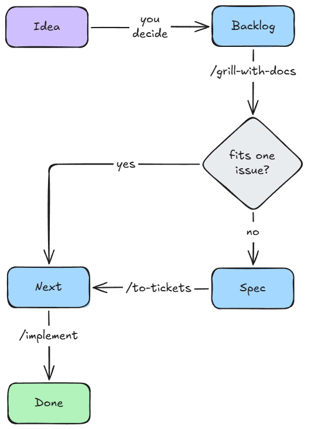

# Skills

Hello everyone, this is my Claude Code setup: 14 skills, and the scripts, hooks and rules that connect them. I use it for solo work on my own projects. You are free to take the parts that are useful to you.

The folders have the same layout as `~/.claude/`. A file that you want goes to the same path there.

## Skills

The skills are in 2 groups. The skills of the first group work alone. The skills of the second group are one workflow.

Each group splits on who can start a skill. A **user-invoked** skill runs only when you type it, for example `/grill-me`. A **model-invoked** skill runs when you type it, and Claude also starts it when the task fits.

### Use alone

Each skill needs only its own folder, or the one other skill that its line names.

**User-invoked**

- **[grill-me](./skills/grill-me/SKILL.md)**: Interviews you about a plan or a design until you and Claude have the same understanding. It asks its questions in rounds, and from round 2 each question comes with a recommended answer. It needs `grilling`.
- **[research](./skills/research/SKILL.md)**: Starts a background agent that answers a question from primary sources. The agent saves the answer in one Markdown file, with a source on each claim and a list of the gaps. It calls `humanize` before it writes.
- **[handoff](./skills/handoff/SKILL.md)**: Writes a handoff file in `.handoffs/` of the repo, with the state, the decisions, the next action and the open problems. A new session reads the file and continues the work. Run it before `/clear`.

**Model-invoked**

- **[grilling](./skills/grilling/SKILL.md)**: The interview rules that `grill-me` and `grill-with-docs` share.
- **[domain-modeling](./skills/domain-modeling/SKILL.md)**: Keeps the terms and the decisions of a project in files. A term goes in `GLOSSARY.md`. A decision that is hard to reverse goes in an ADR in `docs/adr/`.
- **[humanize](./skills/humanize/SKILL.md)**: Writes or rewrites text that a human reads, for example a README, a guide, an ADR or a PR description. It cuts each word that does no work, and it removes the usual AI patterns.
- **[writing-for-agents](./skills/writing-for-agents/SKILL.md)**: The rules for a document that an agent reads, such as a skill, an `AGENTS.md` or a `CLAUDE.md`.

### The workflow

These skills plan, implement, review and ship. They need the scripts, the hooks and the 2 rule files of this repo.

One issue is one Markdown file in the repo. Its `stage` names the next action.

<p align="center">
<picture>
  <source media="(prefers-color-scheme: dark)" srcset="./assets/workflow-dark.png">
  
</picture>
</p>

I usually plan on Opus and implement on Sonnet. Each issue file names the `model` and the `effort` for the session that implements it. One session implements one issue, and `/clear` comes before the next issue.

**User-invoked**

- **[grill-with-docs](./skills/grill-with-docs/SKILL.md)**: The interview of `grill-me`, with `domain-modeling` for the glossary and the ADRs. At the end, it writes the decisions and the acceptance criteria in the issue. An issue that is too big for one ticket gets `stage: spec`.
- **[to-tickets](./skills/to-tickets/SKILL.md)**: Splits a spec into tickets. Each ticket is a thin slice through all layers that you can check alone. It has a maximum of 6 acceptance criteria, and it names the tickets that block it.
- **[implement](./skills/implement/SKILL.md)**: `/implement 042` does one issue from start to end. It makes the change, proves each acceptance criterion, starts a code review on Opus in the background and fixes the findings. Then it closes the issue and ships the work in one commit. If the issue is not clear, it stops. A finding outside the ticket becomes a new issue, if you agree.
- **[audit](./skills/audit/SKILL.md)**: A one-time quality audit of a repo or a folder. It reports ranked findings, for example a bug, a security hole, risky code without tests, a slow path or code to delete. You pick the findings that become issues. It changes no code. It reads the log of the last audit first, so it does not ask about the same finding again.
- **[workflow-review](./skills/workflow-review/SKILL.md)**: Reads the session logs of a time window, scores the sessions on 6 rubrics and proposes changes to the skills and the rules. I run it at the end of an epic. It runs on your machine and uploads no transcript.

**Model-invoked**

- **[add-issue](./skills/add-issue/SKILL.md)**: Makes one issue file from a short request. It takes the next free number, sets the `stage`, the `model` and the `effort`, and ships the file. A clear, small issue goes directly to `next`. "add idea: X" makes an idea with a title and one line of text.
- **[ship](./skills/ship/SKILL.md)**: Makes each commit and each push, through the script `bin/ship`. The script commits only the paths that the session passes, and then it pushes. A hook blocks a direct `git commit` and `git push`.

## The parts behind the workflow

### The issue tracker

The tracker is a folder of Markdown files. It uses no GitHub issues. `issue-tracker.md` is the format doc that the skills read.

- The work folder holds the issues, specs, research and audit logs of a repo. A line in the `AGENTS.md` of the repo names it, for example ``Work folder: `work`.`` With no line, the work folder is `planning`.
- An open issue is at `<work folder>/issues/NNN-<slug>.md`. A closed issue moves to `<work folder>/issues/done/`.
- The frontmatter holds the state: `status`, `stage`, `model`, `effort` and `blocked_by`.
- A ticket has acceptance criteria. Each criterion ends with its proof, so the implementer does not choose how to prove it.
- A closed issue has an `## Answer` that says what changed.

An example of an issue file:

```markdown
---
project: example
status: open
model: sonnet
effort: medium
stage: next
---
# Show the sync time in the status bar

## Acceptance criteria

- [ ] The status bar shows the time of the last sync. (proof: unit test)

## Out of scope

None.
```

The work folder can be a symlink into a second git repo. Then the issue files stay out of the code repo, and `ship` commits and pushes both repos in one call.

### The rules

`workflow.md` holds the rules for all repos: the workflow steps, the size of a ticket, what to do at a blocker, the review rules, the writing rules and the git rules. The line `@~/.claude/workflow.md` in `~/.claude/CLAUDE.md` loads it.

The writing rules ask for ASD-STE100 Simplified Technical English in all prose. That is my preference. Change the section to yours.

### The scripts

`bin/` holds 4 bash commands. A command has no file extension, because the skills call it by name, for example `~/.claude/bin/ship`.

| Command | What it does |
|---|---|
| `ship` | Commits the paths that it gets, pushes, and runs `git pull --rebase` one time if the remote is ahead. |
| `close-issue` | Closes one issue: sets the status and the date, ticks the boxes and moves the file to `done/`. It makes no commit. |
| `next-issue` | Prints the next free issue number. With `--claim`, 2 parallel sessions get different numbers. |
| `work-folder` | Prints the work folder of the repo. |

The scripts and the hooks need `git`, `jq`, `perl` and `flock`.

### The hooks

A hook runs only with an entry in `~/.claude/settings.json`. `settings.example.json` holds the 3 entries.

| Hook | What it does |
|---|---|
| `git-via-ship.sh` | Blocks `git commit` and `git push` in a Bash call, so each commit goes through `ship`. |
| `bash-write-guard.sh` | Blocks a file write from Bash, for example `sed -i` or `echo > notes.md`. Claude then uses the Edit or the Write tool. A write below `/tmp` passes. |
| `worktree-link.sh` | In a git worktree, makes the work folder symlink of the main checkout, and copies the files that `.worktreeinclude` names. |

The second hook is strict. Leave it out if you want Claude to write files from the shell.

### The Explore agent

`agents/Explore.md` replaces the built-in `Explore` agent of Claude Code with a search agent on Haiku. It reports file paths and line numbers, and it gives no opinion. The name has a capital E because it must match the built-in name.

### The output style

`output-styles/adhd-ste.md` is the chat style that I use: the conclusion first, a maximum of 5 bullets and no preamble. The key `"outputStyle": "adhd-ste"` in `settings.json` turns it on.

### Local extensions

`ship`, `implement`, `research`, `workflow-review` and the tracker doc read `~/.claude/local/<name>.md` when the file exists, and follow its steps. `ship` also runs `~/.claude/local/ship.sh`. My private steps are there, and this repo does not hold them. Put your own steps in the same place.

## Credits

`domain-modeling`, `grill-me`, `grill-with-docs`, `grilling`, `research`, `to-tickets` and `writing-for-agents` are forks of [the skills of Matt Pocock](https://github.com/mattpocock/skills). They keep his MIT notice.

`humanize` is built from the `technical-writing` and `unslop` skills of [`pstack`](https://github.com/cursor/plugins/tree/main/pstack). Its `NOTICE.md` has the licence.
